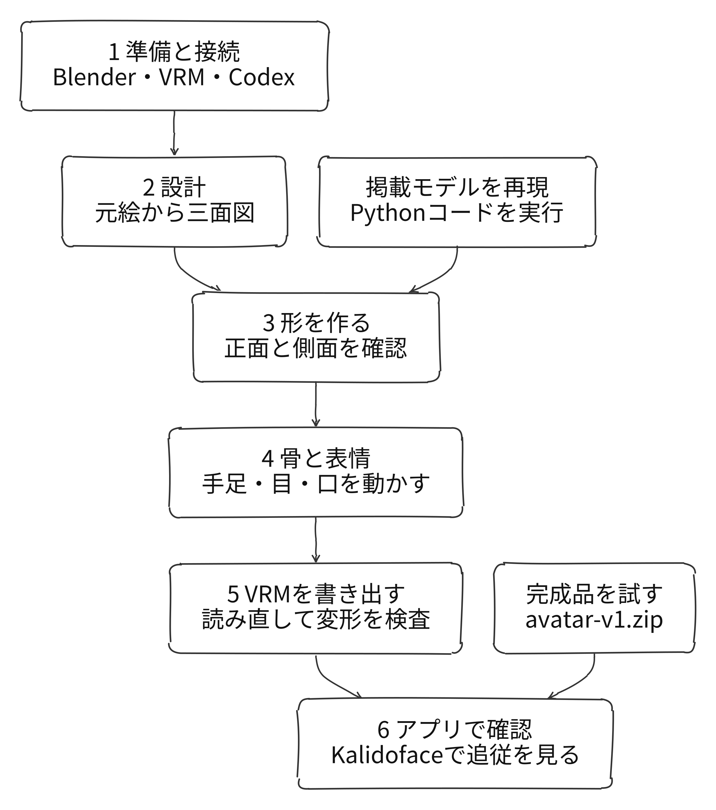
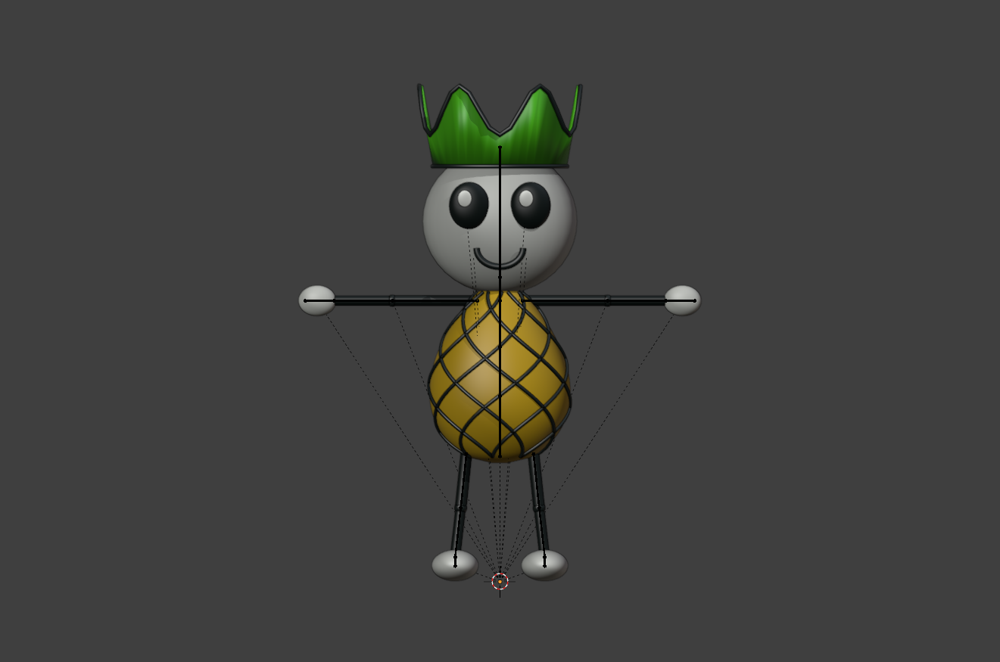
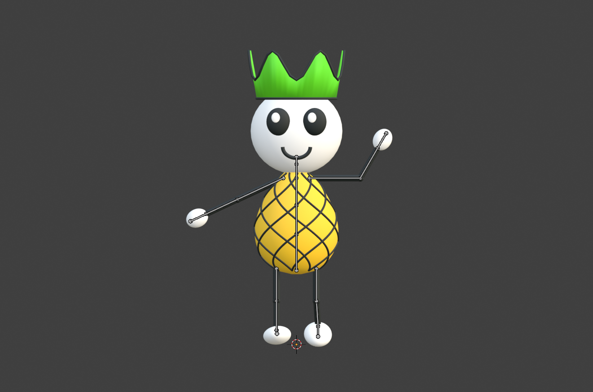

# 自分でアバターを作る

## 仕組み

画像生成ツールは三面図、Codexは形の整理とPythonコード、Blenderは形状・骨・表情、Blender MCPは操作の受け渡しを担当します。VRM用アドオンで人型の骨の役割と表情を含めて書き出します。完成モデルを使うだけならCodexや画像生成は不要です。

## 全体の手順



## 完成品から試す

1. [配布ページ](https://github.com/tyukei/narou-vtuber-samples/releases/tag/advanced-v1)から `avatar-v1.zip` を取得して展開します。
2. [Kalidoface](https://3d.kalidoface.com/)のCharactersから `output/avatar/pineapple-kalidoface.vrm` を読み込みます。VRM 0.x版です。
3. カメラを許可し、頭・手・目・口の反応を確認します。表示に余分な形が見えたらBackgrounds → 2D → Whiteを選んで比較します。
4. VRM 1.0をBlenderで調べたい場合は `pineapple-avatar.vrm` を使います。

## 掲載したマスコットをコードで再現する

Blender 4.5.14 LTSとVRM Add-on for Blender 4.7.2で確認しています。[公式手順](https://vrm-addon-for-blender.info/ja-jp/)でアドオンをインストールして有効化し、新しいBlenderファイルを開きます。Scripting → Newで次を貼り付け、`root`をサンプルの絶対パスに変更してください。

```python
from pathlib import Path
import bpy
root = Path("/absolute/path/to/narou-vtuber-samples")
bpy.context.scene["avatar_project_root"] = str(root)
name = "build_avatar.py"
script = root / "examples/chukei/avatar" / name
exec(compile(script.read_text(encoding="utf-8"), str(script), "exec"))
```

一度実行するごとに `name` を次へ書き換えます。制作専用の新しいシーンを使い、既存の作品を開いた状態では実行しません。

| 順序 | スクリプト | 次へ進む確認 |
|---|---|---|
| 1 | build_avatar.py | Tポーズとpineapple-model.blend |
| 2 | rig_export.py | 骨、pineapple-avatar.blend、VRM 1.0 |
| 3 | check_roundtrip.py | 骨・変形の検査が通りvalidation.jsonができる |
| 4 | export_kalidoface.py | pineapple-kalidoface.vrmができる |
| 5 | check_kalidoface_blender.py | 目と口の変形データの検査が通る |




図は掲載時の実画面です。配布版を再生成したときの検証結果はZIP内のJSONにあります。

## 自分の絵から制作する

[元絵](images/avatar-original.jpg)と[三面図](images/avatar-turnaround.png)も参考にできます。画像の利用範囲は[USAGE.txt](../examples/chukei/avatar/USAGE.txt)を確認してください。

元絵を画像生成ツールへ添付し、次のように依頼します。

```text
添付の絵をBlenderで立体化するための三面図にしてください。
正面・側面・背面を白背景に並べ、頭と足の高さ、縮尺をそろえます。
正面と背面はTポーズにします。残す特徴は［自分の絵の特徴］です。
遠近感を付けず、背面には顔を描かないでください。
見えない部分は正面と矛盾しない単純な形で補ってください。
```

[段階別のプロンプト](../examples/chukei/avatar/REPRODUCE-PROMPTS.txt)で「形 → 骨 → 表情 → VRM書き出し → 再読み込み」を順に依頼します。三面図やプロンプトから同一形状になる保証はありません。同じ掲載モデルを再現するときは前項のPythonを使います。

## 確認できたこと

配布版のVRM 1.0はBlenderで読み直し、40メッシュ、17本の骨、肘・膝の追従、blink・aaを検証しています。VRM 0.xは目と五母音の変形データ、およびKalidofaceと同じ版のローダーでの表情反応を検証します。実カメラでの動作は掲載時の確認であり、配布版の全環境での動作を保証するものではありません。指・視線追従・揺れ物は未実装です。
