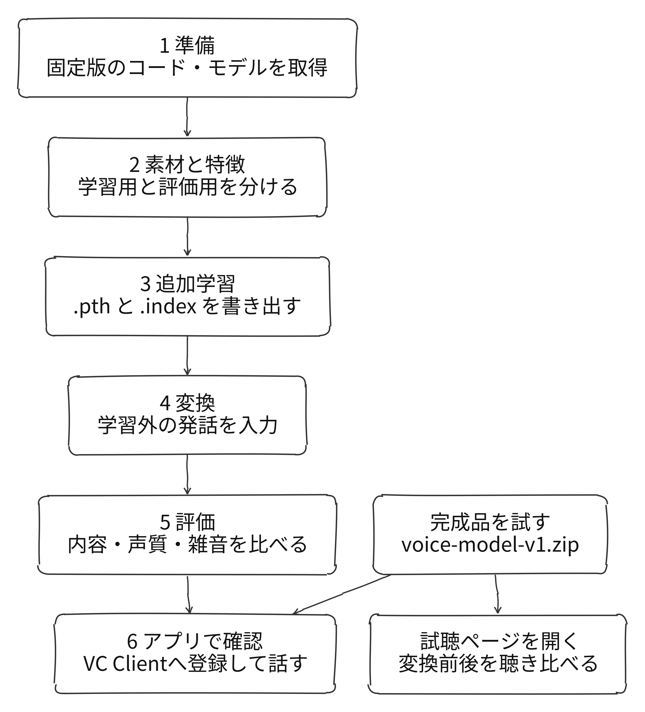
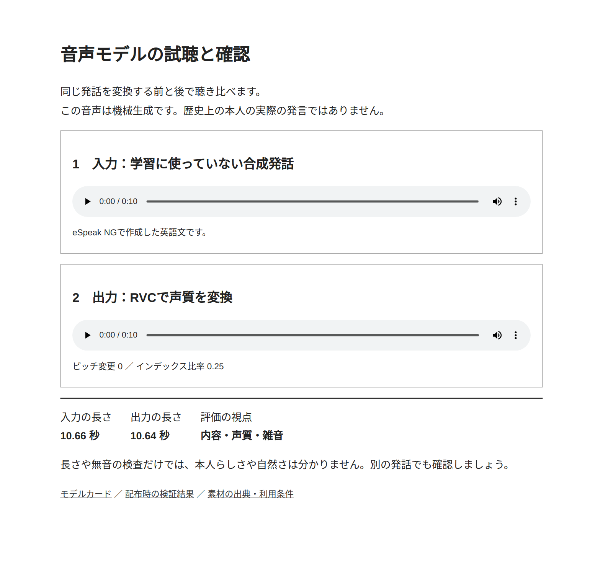

# 自分で音声変換モデルを作る

## 仕組み

RVC v2は、入力音声の発音内容に関係する特徴とピッチから、対象話者の声質の波形を生成します。生成器・識別器の事前学習済み重みを追加学習し、学習音声の特徴から別に検索インデックスを作ります。VITS系の音声生成、HuBERT系の特徴抽出、RMVPEのピッチ抽出、FAISSの検索が役割を分担します。

[公式学習ガイド](https://github.com/RVC-Project/Retrieval-based-Voice-Conversion-WebUI/blob/main/docs/en/training_tips_en.md)、[VITS](https://proceedings.mlr.press/v139/kim21f.html)、[ContentVec](https://proceedings.mlr.press/v162/qian22b.html)、[RMVPE](https://arxiv.org/abs/2306.15412) が背景を調べる入口です。

## 全体の手順

## 完成品から試す

1. [配布ページ](https://github.com/tyukei/narou-vtuber-samples/releases/tag/advanced-v1) から `voice-model-v1.zip` を取得し、サンプルのルートに展開します。
2. `output/voice-model/listen.html` をブラウザで開きます。上下の再生ボタンで合成入力と変換後を聴き比べます。
3. RVC対応のVC Clientで「編集 → 空のスロット → アップロード」を開きます。
4. RVCを選び、`theodore_roosevelt_1912.pth` と `theodore_roosevelt_1912.index` を登録します。Beatrice専用版では使えません。
5. 追加したモデルを選び、マイクとイヤホンを設定して開始します。indexは0.25から試します。

この画面は付属の試聴ページです。VC Clientの画面や、リアルタイム会話を検証した証拠ではありません。

## 自分で追加学習する

Linux、Python 3.12、NVIDIA GPU、Git、curl、FFmpeg、uvを使います。確認環境はRTX 4070 Ti SUPER 16GB、PyTorch 2.7.1+cu118です。

1. [READMEの準備コマンド](../examples/chukei/voice-model/README.txt)で専用環境を作り、`run.py download`を実行します。固定版のRVCと事前学習済み重み、録音を取得します。
2. `run.py prepare`、`run.py features`を実行します。掲載素材では81区間になります。
3. `run.py train --epochs 30 --batch 6`、`run.py export`を実行します。出力先は `output/voice-model/` です。
4. `make_demo_input.py`で入力を作り、`convert.py 入力.wav 新しい出力.wav`で変換します。コマンドの完全な形はREADMEにあります。
5. 長さ・無音・音割れを確認し、入力と出力を聴き比べます。設定調整に使わない別の発話でも確認します。

公式の素材量の推奨はノイズの少ない音声10分以上です。本例は355秒の候補区間から前処理後約295秒を使った小規模な動作実験で、5分で十分な品質を得られるという根拠にはなりません。

## 確認できたこと

配布モデルは保存済みの新しい合成発話を変換できることを再確認しています。従来の25語の例文で単語誤り率0%でしたが、同じ例文で設定を選んでいます。本人らしさ・自然さの主観評価、日本語・歌唱・実マイクでのリアルタイム品質は未検証です。配布ZIPの `MODEL_CARD.txt` と `release-validation.json` に確認範囲を記載しています。
